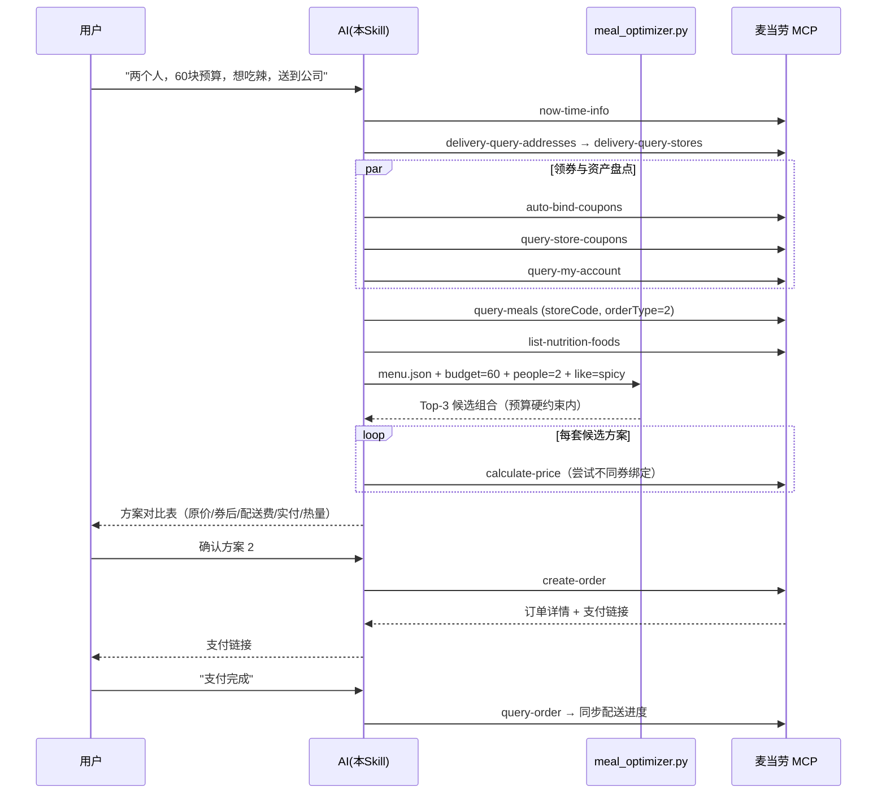

# MCP 集成说明 · 一句话麦麦省钱点单侠

本文档说明本项目实际使用的麦当劳 MCP Server、Tool 清单、调用流程与业务价值。

- **MCP Server**：麦当劳 MCP（Streamable HTTP），接入地址 `https://mcp.mcd.cn`
- **鉴权**：请求头 `Authorization: Bearer <MCD_MCP_TOKEN>`（Token 由[开放平台](https://open.mcd.cn/mcp)申请，仓库内仅以环境变量占位符出现）
- **官方文档**：[M-China/mcd-mcp-server](https://github.com/M-China/mcd-mcp-server)

## 一、使用的 Tool 清单与业务价值

| 阶段 | Tool | 用途 | 业务价值 |
|---|---|---|---|
| 需求解析 | `now-time-info` | 获取当前时间，判断早餐/正餐时段 | 保证菜单解读与推荐符合当下时段 |
| 选店（外送） | `delivery-query-addresses` | 查询用户配送地址 | 免手动输入，直接定位收货点 |
| 选店（外送） | `delivery-query-stores` | 查询地址周边可配送门店 | 自动选择最近可配送门店 |
| 选店（到店） | `query-nearby-stores` | 按位置查询到店自取/得来速门店 | 覆盖自取与车道取餐场景 |
| 领券 | `auto-bind-coupons` | 一键领取麦麦省全部可领券 | **先领券再算价**，避免错过优惠 |
| 领券 | `query-store-coupons` | 查询当前门店可用券 | 核价时选择最优券绑定 |
| 资产 | `query-my-coupons` / `query-my-account` | 查询已有券、积分余额与临期积分 | 券+积分双重省钱素材 |
| 凑单 | `query-meals` | 获取门店实时菜单与价格 | 优化引擎的数据源 |
| 凑单 | `query-meal-detail` | 查询套餐组成与可替换项 | 支持套餐内替换进一步压价/调口味 |
| 凑单 | `list-nutrition-foods` | 获取餐品营养数据 | 人均热量上限约束与营养展示 |
| 核价 | `calculate-price` | 多方案逐一核价（含券、配送费） | **方案对比表的唯一可信价格来源** |
| 下单 | `create-order` | 创建订单并返回支付链接 | 完成"算完直接买"的闭环 |
| 售后 | `query-order` / `order-list` / `cancel-order` | 订单跟踪、历史订单、取消订单 | 支付后状态同步与复购/退单 |
| 彩蛋 | `campaign-calendar` | 查询当月营销活动 | 下单时顺带告知可参与的活动 |

## 二、核心调用时序

## 三、关键设计决策

1. **优化在本地，定价在云端**：组合搜索（可能上万次枚举）由本地引擎完成，避免 MCP 限流（600 次/分钟）；最终金额一律以 `calculate-price` 为准，杜绝"算错价"。
2. **先领券后凑单**：`auto-bind-coupons` 在凑单前执行，保证 `calculate-price` 阶段能用到全部可用券。
3. **不可逆操作二次确认**：`create-order` 前必须展示最终方案与实付金额并获得用户明确同意；`cancel-order` 同理。
4. **beType/beCode 传递规则**严格遵循官方约定：到店自取传 orderType=1 不带 beCode；外送传 orderType=2 + 地址侧 beCode；得来速传 orderType=1 + 门店侧 beCode。
5. **价格单位换算**：MCP 价格字段单位为分，所有对外展示除以 100 转为元。

## 四、限流与容错

- 单 Token 限流 600 次/分钟：菜单/营养数据在单次会话内缓存复用，不重复拉取。
- 429：指数退避重试（1s → 2s → 4s），仍失败则提示用户稍后再试。
- 401：提示用户检查 Token 配置，不输出任何凭证内容。
- 门店无货/券不可用：以 `calculate-price` 返回为准自动降级到下一候选方案。
